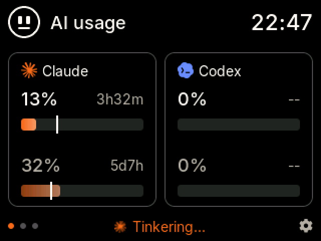
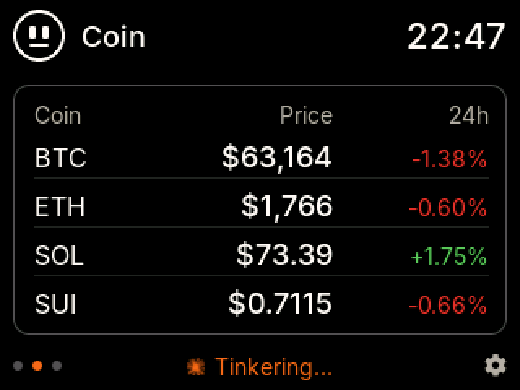
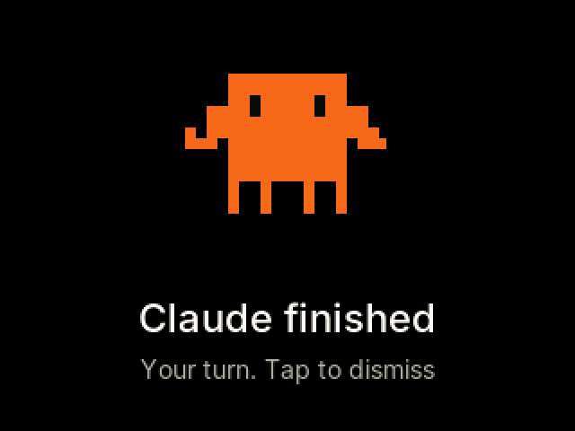
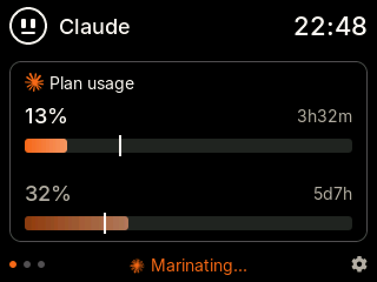
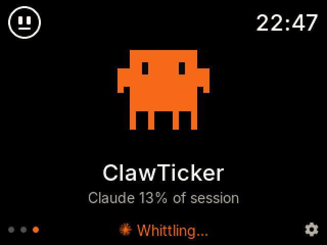
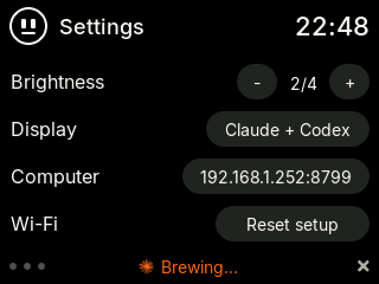

# ClawTicker

A small desk display that shows how much of your **Claude** (and optionally **Codex**) usage limits you have used, a live **coin** price table, and a creature that tells you when your agent has finished a turn. It runs on an ESP32-S3 touch screen board and updates over your home Wi-Fi.

<p>
  
  
  
</p>

```
Claude Code / Codex (your computer) ──> daemon ──HTTP on your LAN──> DIYMORE ES3C28P board
CoinGecko ───────────────────────────────┘
```

> ClawTicker is an independent hobby project. It is not affiliated with or endorsed by Anthropic or OpenAI. See [NOTICE.md](NOTICE.md).

## Contents

1. [What you get](#what-you-get)
2. [What you need](#what-you-need)
3. [Setup in 4 steps](#setup-in-4-steps)
4. [Using it](#using-it)
5. [Configuration](#configuration)
6. [Updating and uninstalling](#updating-and-uninstalling)
7. [Troubleshooting](#troubleshooting)
8. [How it works and privacy](#how-it-works-and-privacy)
9. [Development](#development)
10. [Credits and license](#credits-and-license)

## What you get

| Screen | What it shows |
|---|---|
| **Claude** or **AI usage** | Session (5 hour) and weekly (7 day) usage with bars, time to reset and a white marker for how far you are into each window. Pick **Claude only** (one wide card) or **Claude + Codex** (two cards) |
| **Coin** | A table of 1 to 4 coins: symbol, price, 24h change. Default is BTC |
| **Splash** | An animated pixel creature that changes mood with your usage: relaxed, busy, startled when the session is nearly full, asleep with no data |
| **Finished** | When a Claude Code or Codex turn ends, the board lights up with "Your turn". Tap to dismiss, or it closes by itself after 6 seconds. No hooks to set up, it is detected from the tools' local session logs |
| **Settings** | Brightness, Display mode, computer address, reset Wi-Fi setup |

<p>
  
  
  
</p>

Other touches: a footer with rotating status words, and a custom logo you can upload from your phone during setup. No cloud account or app is needed.

## What you need

**Hardware**

- A **DIYMORE ES3C28P** 2.8 inch ESP32-S3 touch display (16 MB flash, 8 MB PSRAM, ILI9341 panel, FT6336 touch). Make sure it is the **touch** version: the ES3N28P / E32N28P variant has no touch controller. Vendor page: <https://www.lcdwiki.com/2.8inch_ESP32-S3_Display_E32C28P/E32N28P>
- A USB-C **data** cable (some cables only charge)
- A 2.4 GHz Wi-Fi network (ESP32 does not use 5 GHz)

**Computer** (the one you code on, it must stay on and on the same network as the board)

- macOS or Linux. Windows can run the daemon by hand, see [Windows](#windows-experimental)
- Python 3.9 or newer, no extra packages needed
- Claude Code logged in. For the Codex card, the Codex CLI used at least once
- [PlatformIO Core](https://platformio.org/install/cli) to build and flash the firmware (`pip install platformio` or `brew install platformio`)
- git

A 3D-printable case that fits the board: [ClawTicker four-way stand case on MakerWorld](https://makerworld.com/en/models/3491493-clawticker-four-way-stand-case-for-2-8-esp32#profileId-3987622).

Only the DIYMORE ES3C28P is supported. Other boards need different pins and drivers.

## Setup in 4 steps

### 1. Get the code

```sh
git clone https://github.com/nateQQ/clawticker.git
cd clawticker
```

### 2. Install the daemon on your computer

```sh
./install.sh
```

It asks what the screen should show (Claude only, or Claude + Codex), starts the daemon at login, and prints the **computer address** and **port** you will need in step 4, for example `192.168.1.20` and `8787`. On macOS click **Allow** if asked whether `python3` may accept incoming connections.

Check it works:

```sh
curl http://localhost:8787/payload
```

You should see JSON with your usage and coin prices. If the "ai" list shows `"off": 1` or zeros, see [Troubleshooting](#troubleshooting).

### 3. Flash the board

1. Plug the board into your computer with the USB-C data cable.
2. Run:
   ```sh
   ./flash.sh
   ```
   It builds the firmware and uploads it. If it cannot find the board, list ports with `pio device list` and pass yours: `./flash.sh /dev/cu.usbmodem1101` (macOS) or `./flash.sh /dev/ttyACM0` (Linux).
3. If upload fails with "failed to connect", put the board in download mode: hold **BOOT**, tap **RESET**, release **BOOT**, then run `./flash.sh` again.
4. Linux only: if you get "permission denied" on the port, run `sudo usermod -aG dialout $USER` and log out and in.

### 4. Connect the board to Wi-Fi and your computer

On first boot the screen shows **Setup**.

1. On your phone or laptop join the Wi-Fi network **ClawTicker-Setup** (no password).
2. A setup page opens by itself. If it does not, open <http://192.168.4.1> in a browser.
3. Choose your home Wi-Fi, type its password, then enter the **computer address** and **port** from step 2.
4. Optional: choose an image for the **logo** shown top left. It is cropped to a square and shrunk to 32x32 in your browser, with a preview. Tick "Round" for a circle, or "Use the default logo" to go back.
5. Tap **Save and restart**. The board reboots and starts showing data within a few seconds.

Done. Move the board to your desk.

## Using it

- **Tap anywhere** to switch screens: AI usage (or Claude), Coin, Splash.
- **Tap the gear** (bottom right) for Settings, tap the X to leave. The **BOOT** button also switches screens.
- **Settings**
  - *Brightness*: `-` and `+`.
  - *Display*: tap to switch between **Claude only** and **Claude + Codex**. The board remembers it.
  - *Computer*: shows the address the board polls.
  - *Reset setup*: tap twice to erase Wi-Fi and computer settings and open the setup page again. Your logo is kept.
- **Hold BOOT for 5 seconds** at any time to erase Wi-Fi settings, for example if you moved house or the touch screen is not responding.
- **Reading the usage card:** the big number is the share of the window used, the grey time on the right is how long until it resets. The white tick on the bar shows how far through the window you are right now, so a bar ahead of the tick means you are using it faster than the window refills. Bars turn amber at 60 percent and red at 85 percent.
- **Finished screen:** it appears after a Claude Code or Codex turn ends. The board ignores turns that ended before it booted.

### Windows (experimental)

Flashing works the same with PlatformIO. The daemon is plain Python, so run `python daemon\clawticker_daemon.py` from a terminal and enter your PC's IP address on the setup page. There is no installer or autostart for Windows yet, and it has not been tested.

## Configuration

The daemon reads `~/.config/clawticker/config` (created by `install.sh`, template in [daemon/config.example](daemon/config.example)). It re-reads the file on every refresh, so you do not need to restart it, except after changing the port.

| Key | Default | Meaning |
|---|---|---|
| `display` | `claude` | `claude` or `multi`. The default shown by a fresh board. The board's own Settings > Display choice wins once set |
| `coins` | `bitcoin:BTC` | Up to 4 coins as `<coingecko-id>:<SYMBOL>`, comma separated. The id is the "API ID" on each coin's CoinGecko page, for example `bitcoin:BTC, ethereum:ETH, solana:SOL` |
| `vs` | `usd` | Quote currency, any CoinGecko `vs_currency` (for example `eur`, `vnd`) |
| `port` | `8787` | Port the board connects to. Restart the daemon after changing it, and update the board's setup |
| `claude_config_dir` | empty | Which Claude Code account to show. Empty means your default account (`~/.claude`). To show another account point at its config dir, for example `~/.claude-work` |

**Several Claude accounts:** ClawTicker shows exactly one. It reads your default account unless you set `claude_config_dir`. It never picks another account by itself.

**Change the display later without the computer:** on the board, Settings > Display.

## Updating and uninstalling

Update:

```sh
git pull
./install.sh        # refreshes the service
./flash.sh          # only needed if the firmware changed (see CHANGELOG.md)
```

Your Wi-Fi, logo and Display choice stay on the board across flashes.

Uninstall the daemon:

```sh
./install.sh --uninstall
```

This removes the login service but keeps `~/.config/clawticker/config`. Delete that folder to remove everything.

## Troubleshooting

| Symptom | What to try |
|---|---|
| Board says **Waiting for data** or **Cannot reach ...** | Is the daemon running? `curl http://localhost:8787/payload` on your computer. Is the board on the same Wi-Fi as the computer? Is the address right (Settings > Computer)? A VPN or a "guest" Wi-Fi with client isolation blocks it |
| macOS asked about incoming connections and I clicked Deny | System Settings > Network > Firewall > Options, allow `python3`, or turn the firewall exceptions off for it |
| Claude card shows `--` or **not detected** | Log in to Claude Code on the computer, then wait up to 2 minutes. On macOS the login is in the Keychain: you may be asked to allow `security` or Python to read it |
| Wrong Claude account | Set `claude_config_dir` in the config, see [Configuration](#configuration) |
| Codex card shows `--` | Run the Codex CLI once so it creates `~/.codex/sessions`. Usage appears after a session with rate-limit info |
| Coin table is empty | CoinGecko rate limit or no internet on the computer. Check the coin ids in the config. The daemon refreshes every 90 seconds |
| `./flash.sh` cannot connect | Use a data cable, try the other USB-C port on the board, hold BOOT and tap RESET, then retry |
| Screen stays black after flashing | Wrong board. This firmware is only for the DIYMORE ES3C28P (backlight on GPIO 45) |
| Wi-Fi never joins | The board needs 2.4 GHz. Check the password, then Settings > Reset setup |
| Setup page does not open | Open <http://192.168.4.1> by hand. On some phones turn mobile data off while connected to ClawTicker-Setup |
| Wrong colors or mirrored touch | Open an issue with a photo, include the board's marking on the back |
| The Finished screen never appears | It needs a turn to end after the board has booted. Check `~/.claude/projects` or `~/.codex/sessions` exists and is being written |

Daemon log (macOS): `~/.config/clawticker/daemon.log`. Linux: `journalctl --user -u clawticker`.

For deeper debugging connect to the board over USB serial at 115200 baud, see [docs/serial-commands.md](docs/serial-commands.md): `status` shows Wi-Fi, address, uptime and the last reset reason.

## How it works and privacy

- **Claude usage:** the daemon sends a one-token request every 2 minutes using the OAuth token Claude Code already stored on your computer (macOS Keychain, or `~/.claude/.credentials.json`). The response headers carry the plan utilization. This costs a negligible amount of quota. It relies on API behavior that is not an official usage endpoint, and may change.
- **Codex usage:** read from the rate-limit events Codex writes to `~/.codex/sessions`.
- **Finished alerts:** the newest session logs under `~/.claude/projects` and `~/.codex/sessions` are checked every 3 seconds for a turn that just ended. Nothing in them is stored or sent anywhere.
- **Coins:** CoinGecko public API, cached by the daemon so the board never talks to the internet.
- **Your token** never leaves your computer except to `api.anthropic.com`.
- **The daemon listens on your local network without a password** and only returns usage numbers, coin prices and a turn counter. Run it on a network you trust and do not expose its port to the internet.
- The board stores Wi-Fi credentials and your logo in its flash. "Reset setup" or holding BOOT for 5 seconds erases the Wi-Fi settings.

The format the board reads is documented in [docs/payload.md](docs/payload.md).

## Development

```sh
python3 -I -m unittest discover -s daemon/tests   # daemon tests
cd firmware && pio run                              # build the firmware
cd firmware && pio run -t upload                    # build and flash
python3 tools/shot.py /dev/cu.usbmodemXXXX out.png  # screenshot the board over USB (needs pyserial, pillow)
python3 tools/gen_icons.py                          # regenerate icons from assets/logos
python3 tools/gen_sprites.py                        # regenerate sprites from assets/mascot
```

Layout:

```
daemon/        Python daemon: Claude, Codex, coins, turn detection, HTTP /payload
firmware/      PlatformIO project (Arduino, LVGL 9, ESP32-S3)
  src/         ui.cpp screens, net.cpp polling, portal.cpp setup page, hw.cpp panel + touch
  src/fonts/   Inter bitmap fonts (SIL OFL)
assets/        logos and mascot sprite source data
tools/         screenshot and asset generators
docs/          payload format, serial commands, hardware notes, screenshots
```

See [CONTRIBUTING.md](CONTRIBUTING.md) before sending a pull request, [docs/hardware.md](docs/hardware.md) for the pinout and [CHANGELOG.md](CHANGELOG.md) for what changed.

## Credits and license

Code is released under the [MIT license](LICENSE). Third-party material and trademarks are listed in [NOTICE.md](NOTICE.md):

- UI font: [Inter](https://rsms.me/inter/) (SIL Open Font License 1.1)
- Claude and Codex marks: from [lobe-icons](https://github.com/lobehub/lobe-icons) (MIT). The marks are trademarks of Anthropic and OpenAI and only identify the services whose usage is shown
- Pixel creature: [ClaudePix](https://claudepix.vercel.app/) by [@amaanbuilds](https://x.com/amaanbuilds). ClaudePix states no licence, so it is included for credit only and will be replaced on request, see [assets/mascot/README.md](assets/mascot/README.md)
- Libraries fetched at build time: LVGL (MIT), GFX Library for Arduino (BSD-3-Clause), ArduinoJson (MIT)
